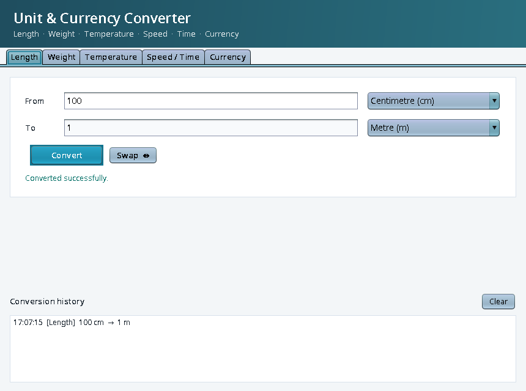
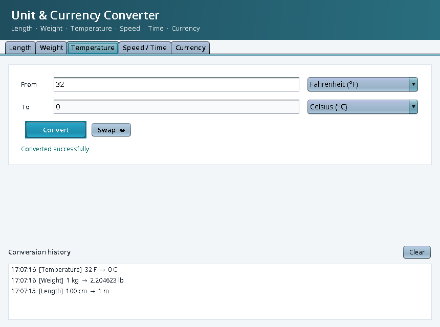
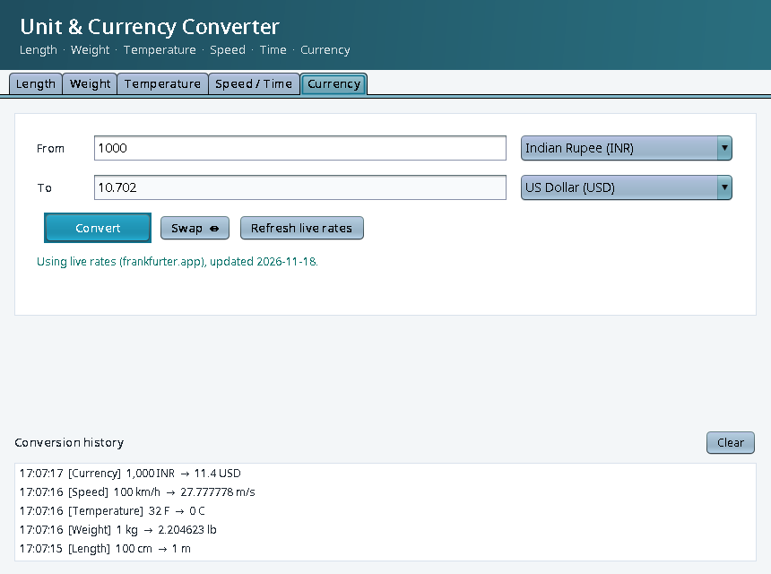

# Unit & Currency Converter

A Java Swing desktop app that converts length, weight, temperature, speed, time and currency. Currency conversion works offline from a bundled INR-based rate file, and a **Refresh live rates** button can optionally download up-to-date rates from a free public API. If there is no internet connection, the app keeps using the offline rates.

Built as a student project by **Mansi Harshal Patil**.



## Features

- Tabs for **Length**, **Weight**, **Temperature**, **Speed / Time** and **Currency**
- Instant conversion as you type, plus a Convert button
- Swap button to flip the two units
- Shared conversion history at the bottom of the window (with Clear)
- Input checks for empty values, non-numeric text and negative amounts (temperatures may be negative)
- Currency rates stored as “units of foreign currency per 1 INR”
- Offline fallback rates in `resources/currency_rates.txt`
- Optional live refresh using [Frankfurter](https://www.frankfurter.app/) (`https://api.frankfurter.app/latest?from=INR`), with a backup call to [open.er-api.com](https://www.exchangerate-api.com/) — no API key required
- If the live request fails or times out, the previous offline rates are kept and a clear message is shown
- Successful live rates are saved to `data/currency_rates.txt` and reused the next time the app starts
- Conversion logic is separate from the user interface (`converter` vs `converter.ui`)

## Tech stack

Java 11+ (compiled and tested on Java 21) · Java Swing (Nimbus look and feel) · `java.net.http.HttpClient` for live rates · no external libraries

## How to run

You need a JDK (Java 11 or later).

**Compile**

```bash
# macOS / Linux
chmod +x compile.sh run.sh
./compile.sh

# Windows (Command Prompt)
javac -encoding UTF-8 -d out src/converter/*.java src/converter/ui/*.java
copy resources\currency_rates.txt out\currency_rates.txt
```

**Start the program**

```bash
# macOS / Linux
./run.sh

# Windows
java -cp out converter.ui.ConverterApp
```

**Run the logic tests** (no window is opened)

```bash
java -cp out converter.ConversionLogicTest
```

### Using the currency tab

1. Choose the From and To currencies and type an amount.
2. Click **Convert**, or just let it update as you type.
3. Click **Refresh live rates** if you are online and want current figures. If the request cannot be completed, the app continues with the offline file.

Supported currencies: INR, USD, EUR, GBP, JPY, AUD, CAD, SGD, AED, CNY, CHF, NZD.

### Units included

| Tab | Units |
| --- | --- |
| Length | mm, cm, m, km, inch, foot, yard, mile |
| Weight | mg, g, kg, tonne, ounce, pound |
| Temperature | Celsius, Fahrenheit, Kelvin |
| Speed | m/s, km/h, mph, knot |
| Time | second, minute, hour, day, week |

## Project structure

```
unit-currency-converter/
├── README.md
├── .gitignore
├── compile.sh
├── run.sh
├── resources/currency_rates.txt   # bundled offline rates
├── data/                          # saved live rates (created after a refresh)
├── screenshots/                   # window previews
└── src/
    ├── converter/                 # conversion logic (no Swing)
    │   ├── FactorConverter.java
    │   ├── TemperatureConverter.java
    │   ├── CurrencyConverter.java
    │   ├── CurrencyRates.java
    │   ├── LiveRateClient.java
    │   ├── ConversionHistory.java
    │   ├── InputValidator.java
    │   └── ConversionLogicTest.java
    └── converter/ui/              # Swing window
        ├── ConverterApp.java
        ├── ConverterFrame.java
        ├── UnitConversionPanel.java
        ├── CurrencyPanel.java
        └── HistoryPanel.java
```

## Screenshots

| Length | Temperature | Currency |
| --- | --- | --- |
|  |  |  |
